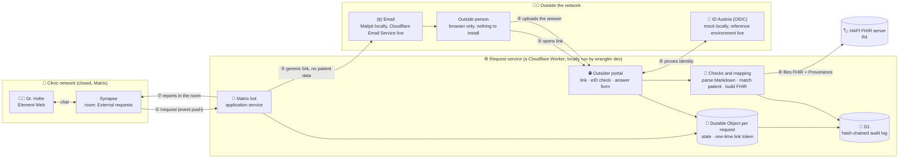

# External document requests for the PGK network (Track 2: Health Data Interoperability)

A doctor in the closed network asks someone outside it for a document. The outside person gets a generic link by email or SMS, proves who they are with an electronic ID, answers in the browser, and the service files the answer as validated FHIR R4 and tells the doctor in Matrix. No account, no install for the outside person.

The original brief is in [`docs/challenge-brief.md`](docs/challenge-brief.md); the synthetic scenario is in [`scenario/`](scenario/).

## Run it locally

Everything runs in Docker on your machine. You need **Docker with Compose v2** (`docker compose version` should work) and nothing else: no Node, no accounts, no keys. All data is synthetic. The first start downloads images and builds one, so allow a few minutes.

**1. Get the code and start everything**

```bash
git clone https://github.com/skauk/synapse.git
cd synapse
docker compose up --build -d --wait
```

The command returns when every service is ready. Then `docker compose ps` shows all services as `running` (healthy), except `matrix-init` and `seed`, which do their one-off setup and show `exited (0)`.

It uses these ports on `localhost`: **8080** (FHIR server), **8008** (Matrix server), **8081** (Element), **8787** (the service) and **8025** (Mailpit). If one is taken, either stop what uses it or start with another Mailpit port: `MAILPIT_PORT=8026 docker compose up --build -d --wait`.

**2. Open the doctor's chat**

Open http://localhost:8081 and sign in as **`lena.hofer`** with password **`demo-only-lena`** (the server `klinikum.example` is preselected). If Element offers to set up secure backup or verify the session, skip it: the room is not encrypted. Open the room **External requests**. The bot `pgkbot` is in it. Type `!help`; it answers within a few seconds. (Right after the first start it can take up to half a minute until the bot has joined.)

**3. Ask an outside person for a lab result**

In the room, type:

```
!request lab "Dr. Eva Brandl" eva.brandl@labor-kanal.example maria-beispiel
```

The bot confirms. Nothing is really sent: **Mailpit** catches the email.

**4. Open the email as that person**

Open http://localhost:8025 (Mailpit), open the new email and click its link. The email and the page behind the link name no patient and no document type. Click **Identify with ID Austria**. This is a **mock** eID, a page where you choose who logs in, because the real ID Austria needs a service provider registration that cannot be shared. Choose **Eva Brandl**.

**5. Answer**

The page now shows what is requested (patient Maria Beispiel, a lab result). Upload `scenario/documents/lab-result-maria-beispiel.md` from this repository and send it.

**6. See the result**

- In Element, the bot reports that the result is filed and how the identity was checked.
- The FHIR resources are on the FHIR server: http://localhost:8080/fhir/Observation and http://localhost:8080/fhir/DiagnosticReport.
- The simulated SMS and the messages sent to the doctor are listed at http://localhost:8787/outbox.
- Every step is in the audit log. The id is the part of the link after `/r/`:
  `curl -H "authorization: Bearer demo-bot-token" http://localhost:8787/api/requests/<id>/audit`

**7. Try the misdelivery cases** (repeat step 3 for each, then at the mock eID page choose as follows)

| You choose or upload | What happens |
|---|---|
| **Susi Fremd** (a stranger opens the link: wrong address) | Refused, nothing shown, the failed check is in the audit log |
| **Karl Kollege** (a colleague the request was forwarded to) | Refused, the same |
| **Eva Brandl (low assurance)** (right person, eID too weak) | Refused: required eIDAS level not reached |
| **Eva Brandl**, then upload `scenario/documents/lab-result-max-beispiel.md` | Wrong patient: not filed, the doctor is warned in the room |
| **Eva Brandl**, then upload `scenario/documents/rehab-report-maria-beispiel.md` | Wrong document type: not filed |

The rehab report works too: `!request rehab "Stefan Kern" "+43 660 000 0101" maria-beispiel`, choose **Stefan Kern** at the mock eID page and upload `scenario/documents/rehab-report-maria-beispiel.md`. The SMS with the link is shown at `/outbox`.

**8. Stop and clean up**

```bash
docker compose down -v      # stops everything and deletes the data
```

### If something does not work

| Symptom | What to do |
|---|---|
| `port is already allocated` or `address already in use` | Another program uses one of the ports above. Stop it, or change the Mailpit port as described. |
| The bot does not answer `!help` | Wait half a minute and try again. Check `docker compose ps` (`worker` must be healthy) and `docker compose logs worker`. |
| Element cannot sign in | Check that `docker compose ps` shows `synapse` healthy. Username `lena.hofer`, password `demo-only-lena`. |
| The link in the email does not open | It must be opened in a browser on the same machine (`http://localhost:8787/...`). |
| Start over from scratch | `docker compose down -v`, then step 1 again. |

### Optional: run the automated tests and the FHIR validator

With the stack running, and **Node 22** installed (`npm install` once):

```bash
npm test                       # 31 unit tests
node test/e2e.mjs              # 33 checks: identity, FHIR, misdeliveries, audit (mock eID)
node test/matrix-e2e.mjs       # 13 checks through Matrix (set MAILPIT_PORT if you changed it)
./scripts/validate-fhir.sh     # HL7 validator on every resource we file (needs Java, downloads the validator)
```

Last runs on a cold start from a clean copy of the repository: all of the above pass, and the validator reports 0 errors.

## Architecture



| Component | Role | Built or used | Replaceable by |
|---|---|---|---|
| Worker (`src/`) | All service logic | Built (TypeScript, Hono, `jose`) | Any runtime for Workers-style code |
| Durable Object `RequestDO` | Per-request state, link token (stored hashed), attempt counter and lockout, one answer per request | Built | A database row with a lock |
| D1 | Audit log, outbox, event dedupe | Used | Any SQL database |
| Identity provider | Proves who the outside person is | `OidcProvider` (ID Austria) and `MockProvider` behind one interface | Any OIDC or eIDAS provider; set `IDP` and the OIDC settings |
| Matrix | Closed network | Synapse + Element Web (Docker), bot as an application service | Any Matrix server |
| FHIR server | Storage | HAPI (Docker) or the public HAPI test server | Any FHIR R4 server |
| Mail and SMS | Delivery of the generic link | Email: Cloudflare Email Service (`src/mail.ts`), sender `requests@dingsbums.click`. Both channels are also recorded in D1 (`/outbox`, with a delivery status). SMS: simulated only | Any mail API or SMS gateway: `deliverMail` in `src/mail.ts` |
| HL7 validator | Quality gate | `validator_cli.jar`, run by `scripts/validate-fhir.sh` | – |

**No AI model is used.** Parsing is deterministic, so the patient check, the FHIR mapping and the identity decision never depend on model output. That was a deliberate choice for the safety-relevant steps.

## Flow

1. Dr. Hofer writes `!request lab "Dr. Eva Brandl" eva.brandl@labor-kanal.example maria-beispiel` in her room. Only members listed in `MATRIX_MEMBERS` may. The patient is looked up on the FHIR server, so name and birth date come from the record.
2. The service stores the request and "sends" a message with a link. The message names the sender and organisation only: no patient name, birth date or document type.
3. The link page shows nothing about the request. The person identifies with their eID.
4. The eID must reach the required eIDAS level (`MIN_LOA`, default substantial) and its name must match the person named in the request. Five name mismatches lock the request.
5. Only now does the page show which patient and document are requested. The person uploads or pastes the Markdown.
6. The service checks that the document is the requested kind and is about the right patient (name and birth date), builds the FHIR resources and files them in one transaction.
7. Dr. Hofer is told in her room, including how the identity was checked. Every step is written to the audit log.

## Design answers

**1. How does an outside person prove who they are if they are in no directory?**
With an electronic ID that does not depend on any directory of ours: ID Austria, which is an eIDAS-notified scheme. The doctor only knows a name, a role and a contact, so the check is that the verified eID name matches the named person. The email or SMS link is only a delivery path, and holding it proves nothing: a wrong or forwarded link is rejected because the eID name does not match. The link token is random, stored hashed and expires after 7 days.

**2. Which identity check do you require for each document type, and why?**
Both the lab result and the rehab discharge report require the same check: eID login plus name match. Lab values drive a clinical decision and a wrong value can cause harm, and the discharge report contains medication, so a channel-only check (a code sent to a phone) is not enough for either: SIM swaps, shared inboxes and forwarding break it. We did not set a weaker tier for the rehab report. The eID must reach eIDAS level substantial (`MIN_LOA`; ID Austria reports `high`), and an unknown level never passes. The level and method are recorded in the Provenance. A qualified electronic signature over the answer would add non-repudiation and is not built. For the rehab report the sender (Stefan Kern, verified) is not the author (Dr. Leitner, as written in the document), and the Provenance records both.

**3. Which FHIR resources do you create and how do they reference each other and the patient?**
All clinical resources point at the existing `Patient` (`subject`). A `ServiceRequest` (the doctor's request) is referenced by the results (`basedOn`, or `context.related` for the document).
- Lab: one `Observation` per row (LOINC code, UCUM value and unit, reference range, interpretation, `effectiveDateTime` from the sample time, `issued` from the report time) and a `DiagnosticReport` whose `result` lists them.
- Rehab: a `DocumentReference` (LOINC 18842-5 Discharge summary) with the Markdown attached as `text/markdown`, the stay as `context.period` and the author and custodian.
- Supporting: `Practitioner` (requesting doctor, verified sender, author if different), `Organization`.
- One `Provenance` whose `target` is every clinical resource. Its agents are the author and the sender (type `enterer`). The sender's agent has a coded `role` that records the method and level of the identity check (e.g. `id-austria-high`; the level is normalised from the eIDAS URI the IdP sends) and the text with the time of the check. Times taken from the documents carry the Vienna offset.
- Ids derive from the request id, so filing the same answer twice overwrites instead of duplicating.

**4. How do you notice a misdelivery?**
- **Wrong address (M1) and forwarded request (M2):** the eID name does not match the named person. Nothing about the request is shown, no answer is accepted, and the failed check is in the audit log with the name and a hash of the bPK of the person who tried. A correct person with an eID below the required level is refused the same way (reason `assurance_too_low`).
- **Wrong patient (M3):** the document's patient name and birth date are compared with the request. A mismatch is not filed, Dr. Hofer is warned in her room and `misdelivery_caught` is logged. The warning names the mismatching fields but not the other patient's data.
- **Wrong document type:** a rehab report for a lab request is refused the same way.
- Not built: a warning at request time when the typed domain looks like a typo of a known one.

**5. Where does your service run?**
The prototype runs on Cloudflare Workers, which is a third party, with the FHIR server and Matrix local or at the clinic. That is a trade-off we accept for a demo only. The service keeps request metadata (including the patient name for the match) and the audit log, and the answer passes through it to the FHIR server without being stored. For real use we would run it at the clinic: the code uses only standard Workers APIs plus a Durable Object and a SQL database, so it can run on the open-source `workerd` runtime inside the clinic's own network, with only the portal reachable from outside. We would not run it at the outside organisation, which cannot be trusted to enforce the checks.

## Metrics on the scenario

| Metric | Result | How measured |
|---|---|---|
| FHIR validation | **0 errors** on all 18 resources (lab set, rehab set, patient), 3 warnings (2 about our own undefined code system, 1 about the organizers' `patient.json` having no narrative) | `scripts/validate-fhir.sh` (HL7 validator, R4) |
| Effort for the outside person | **0 installs, 0 accounts** (an existing ID Austria is assumed). Time from opening the email to sending: not yet measured with a new person | To do with a stopwatch on a new person. The audit log of the one real login shows 1 min 37 s from opening the link to the identity check and 1 min 12 s from there to sending (about 2 min 50 s in total), but that was the developer exploring, not a timed run, and it is over the 2 minute target |
| Misdeliveries caught | **3 of 3** with the mock IdP | `node test/e2e.mjs` and `node test/matrix-e2e.mjs` |
| Audit coverage | **6 of 6** steps, each with who, what and when; the hash chain verifies and a tampered or deleted entry is detected | `node test/e2e.mjs`, `GET /api/audit/verify` |

The end-to-end checks use the mock IdP, not the real ID Austria.

## Public demo server (optional, not needed to run the project)

The same bot also ran on a deployed Cloudflare Worker (`https://synapse.skauk.workers.dev`) against a public Synapse that was exposed through a Cloudflare Tunnel for one day. The files for that Synapse are in [`deploy/homer/`](deploy/homer/); nothing there is needed to run the project locally. In that setup anyone with a registration token gets an account, joins the room and types `!request ...` with their own email address and a **test** ID Austria identity. Limits: 10 commands per Matrix user, only on 2026-10-30, and only the demo patient `aimh-skauk-maria-beispiel` on the public HAPI server. These are settings in `wrangler.jsonc` (`MATRIX_OPEN`, `BOT_MAX_MESSAGES`, `BOT_ACTIVE_DATE`, `ALLOWED_PATIENTS`). Real emails go out from `requests@dingsbums.click` through Cloudflare Email Service.

Email safety: addresses on reserved domains (`.example`, `.test`, `.invalid`, `localhost`, `example.com/org/net`) are never sent to, as the brief asks, and the outcome of every send (`sent`, `not sent: reason`, `failed: error`, `redirected`) is stored in the outbox and the audit entry. `MAIL_REDIRECT_TO` sends every request email to one mailbox you control, with "meant for <address>" in the subject, so a demo can show a real email without contacting the scenario's fictional recipients.

`wrangler.jsonc` is the deployed configuration. For `npm run dev` outside Docker (needs the stack's FHIR and Matrix servers), `.dev.vars` (gitignored; see `.dev.vars.example`) overrides it. The mock IdP only runs when `BASE_URL` is `http://localhost…`.

## Real ID Austria

`src/identity/oidc.ts` is a generic OIDC client (authorization code, PKCE, JWKS verification) configured for the ID Austria **reference environment** (`https://idp.ref.id-austria.gv.at`). Per its discovery document it offers the scopes `openid profile`, `client_secret_post` and the `claims` request parameter, with attributes returned in the ID token (there is no userinfo endpoint), so the adapter requests them with `claims`.

The service provider version is registered with the redirect URL `https://synapse.skauk.workers.dev/auth/callback`. The client ID is the version's friendly URL (`https://kauk.at`); the "API ID" shown in the registration portal is rejected by the IdP. The probe `scripts/probe-idp.sh` tells accepted from rejected client IDs without credentials.

Status: one real login with a reference-environment test identity succeeded on the deployed Worker, and the answer was filed. The ID token carried the name claims, a bPK and the level (`acr` = `http://eidas.europa.eu/LoA/high`, even though the "ID Austria Level" attribute is not selected in the registration). Which of the configured candidate claim names matched was not recorded for that login; the audit entry now records it (`claimsUsed`, names only). Only a test identity has been used, never a real person's eID.

## Layout

```
src/index.ts          routes: request API, outsider portal, audit API, Matrix app service, mock helpers
src/request-do.ts     per-request state (Durable Object)
src/identity/         IdentityProvider, OIDC (ID Austria), mock
src/parse.ts          Markdown → structured answer
src/fhir.ts           structured answer → FHIR bundle (pure, tested, validated)
src/fhir-client.ts    filing and patient lookup
src/matrix.ts         bot commands and application service
src/audit.ts          hash-chained audit log
migrations/           D1 schema
docker-compose.yml    the whole local stack: the one file to run
Dockerfile, docker/   the Worker image and the Synapse and seed scripts used by the stack
deploy/homer/         optional: the public Matrix server of the live demo (not needed locally)
scripts/              FHIR validation, ID Austria probe, patient seed
test/                 unit tests and end-to-end scripts
```

## Limitations

This is a prototype. The eID check is real only against the ID Austria reference environment with test identities, never a real person's eID, and the automated tests use the mock IdP. The identity check matches the eID name to the name the doctor typed, so two people with the same name cannot be told apart; the bPK is recorded but not yet bound to a person across requests. The answer has no qualified electronic signature, and nothing warns at request time when an address looks like a typo of a known domain. We accept only the Markdown format as an upload or pasted text (the patient is identified by its header), not a typed-in form. Filing is not queued: if the FHIR server is down the person sees an error and has to submit again. The rehab report is attached as text and its medication list is not mapped to FHIR resources. SMS is only simulated, as no gateway is connected. The Matrix room is not end-to-end encrypted, because the bot could not read an encrypted room. The service runs on Cloudflare Workers, a third party, which is acceptable for a demo but not for patient data; the answer to design question 5 describes how a clinic would run it. The time an outside person needs has not been measured with a new person.
