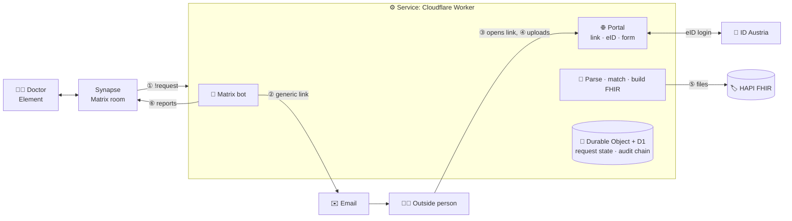

# External document requests for the PGK network

This is a solution to the problem of the **Health Data Interoperability** track of **Healthcare Hackathon 2026**, held in Vienna, Austria, on 29–30 October. The solution comes from the team **Synapse**. ([Brief](docs/challenge-brief.md))

A doctor in a closed Matrix network asks someone outside it for a document. The outside person gets a generic link by email, proves who they are with an electronic ID, answers in the browser, and the service files the answer as validated FHIR R4 and tells the doctor in the same Matrix room. No account, no install for the outside person. (SMS is simulated.)

## Components



| Component | Role |
|---|---|
| Synapse and Element | The closed network. The bot is a Matrix *application service* and answers in the doctor's room. Runs with Docker Compose. |
| Cloudflare Worker (TypeScript) | All logic. One Durable Object per request holds its state and one-time link token; D1 holds the audit log. |
| ID Austria (OpenID Connect) | Identity of the outside person: reference environment, test identity. |
| HAPI FHIR | Storage of the filed resources, checked with the HL7 validator. |
| Cloudflare Email Service | Delivers the link (Mailpit locally). |

## What is special about our approach

- **The eID proves identity, not the channel.** The email link is only delivery. The eID name must match the person the doctor named, at eIDAS level substantial or higher. A mistyped address or a forwarded link fails.
- **Nothing sensitive before identification.** Emails and the link page name no patient, birth date or document type.
- **Misdeliveries are caught and reported to the doctor in Matrix:** wrong person, wrong patient (name and birth date), wrong document type.
- **FHIR with provenance.** A Provenance resource records the sender, the author and how the identity was checked (method, level, time). 0 errors in the HL7 validator.
- **Hash-chained audit log** of all six steps.
- **Deterministic, no AI model** in the identity, matching and mapping steps.

## Answers to the track's questions

1. **How does an outside person prove who they are without a directory?** With ID Austria, an eIDAS-notified eID. The doctor only knows a name and a contact, so the check is that the eID name matches the named person. The link proves nothing by itself.
2. **Which check per document type?** The same for both: eID login, name match and minimum level substantial. Lab values drive clinical decisions and the discharge report contains medication, so a code sent to a phone or inbox is not enough (SIM swap, shared inbox, forwarding). For the rehab report the verified sender can differ from the author; the Provenance records both.
3. **Which FHIR resources?** Lab: an `Observation` per value (LOINC, UCUM, reference range) and a `DiagnosticReport` listing them. Rehab: a `DocumentReference` with the text attached. All point to the `Patient` and to a `ServiceRequest` for the doctor's request, with `Practitioner` and `Organization`. One `Provenance` targets everything filed.
4. **How is a misdelivery noticed?** Wrong address or forwarded link: the eID name does not match, nothing is shown, the attempt is audited. Wrong patient or document type: the document is compared with the request, it is not filed, and the doctor is warned in the room.
5. **Where does the service run?** The prototype runs on Cloudflare, a third party, which is fine for a demo. For real use a clinic would run it itself: the code uses standard Workers APIs, a Durable Object and SQL, so it runs on the open-source `workerd` inside the clinic network, with only the portal reachable from outside.

## Results on the scenario

| Metric | Result | Measured with |
|---|---|---|
| FHIR validation | **0 errors** on all 18 resources. 3 warnings: two for our own code system in the Provenance resources, one for the organizers' `patient.json` having no narrative. | `docker compose run --rm validate` |
| Effort for the outside person | **0 installs, 0 accounts** (an ID Austria identity is assumed). Time not yet measured with a new person; one real run, read from its audit log, took about 2 min 50 s (the developer exploring, over the 2-minute target). | Manually, with a stopwatch, following the steps below |
| Misdeliveries caught | **3 of 3** with the mock eID: wrong address, forwarded request, wrong patient. | `docker compose run --rm tests` |
| Audit coverage | **6 of 6** steps with who, what and when. The chain detects edits and removals inside it, not removal of the newest entries. | `docker compose run --rm tests` |

## Run it locally

**Requirements:** Docker with Compose v2.

```bash
git clone https://github.com/skauk/synapse.git && cd synapse
docker compose up --build -d --wait      # a few minutes the first time
```

1. Open http://localhost:8081, sign in as `lena.hofer` / `demo-only-lena` (dismiss any backup prompt), open the room *External requests*.
2. Send: `!request lab "Dr. Eva Brandl" eva.brandl@labor-kanal.example maria-beispiel`
3. Open Mailpit at http://localhost:8025 and follow the link in the email.
4. At the mock eID page choose **Eva Brandl**, then upload `scenario/documents/lab-result-maria-beispiel.md`. The bot reports the result in the room. For the refusals, choose **Karl Kollege** or **Susi Fremd**, or upload `lab-result-max-beispiel.md` (wrong patient).

```bash
docker compose run --rm tests       # unit, end-to-end and Matrix tests
docker compose run --rm validate    # HL7 FHIR validator
docker compose down -v              # stop and delete all data
```

Port 8025 busy? Prefix the first command with `MAILPIT_PORT=8026`.

## Try it on the public deployment

Available on **30 October 2026** only. ID Austria's reference environment accepts **test identities only**. Limits: 10 messages per user, one demo patient. Without an Austrian eID, use the local setup above, which includes a mock eID.

1. **Register a test identity** at https://www.a-trust.at/TestIdentitaetenManagement (the portal asks you to sign in with Handy-Signatur or Bürgerkarte). Note its given name and family name.
2. Open https://element.dingsbums.click/#/room/#requests:klinikum.example and choose **Create account**. When asked for a registration token, enter `healthcare-hackathon`.
3. In the room *External requests*, send this message, with the name of your test identity exactly as registered and your own email address:

   ```
   !request lab "<given name> <family name>" your.name@example.org aimh-skauk-maria-beispiel
   ```

4. Open the email from `requests@dingsbums.click` (**check your spam folder**) and follow the link.
5. Choose **Identify with ID Austria** and log in with the test identity. Upload `scenario/documents/lab-result-maria-beispiel.md` from this repository.
6. The result appears in the same room, with how your identity was checked. `!help` explains the command.
